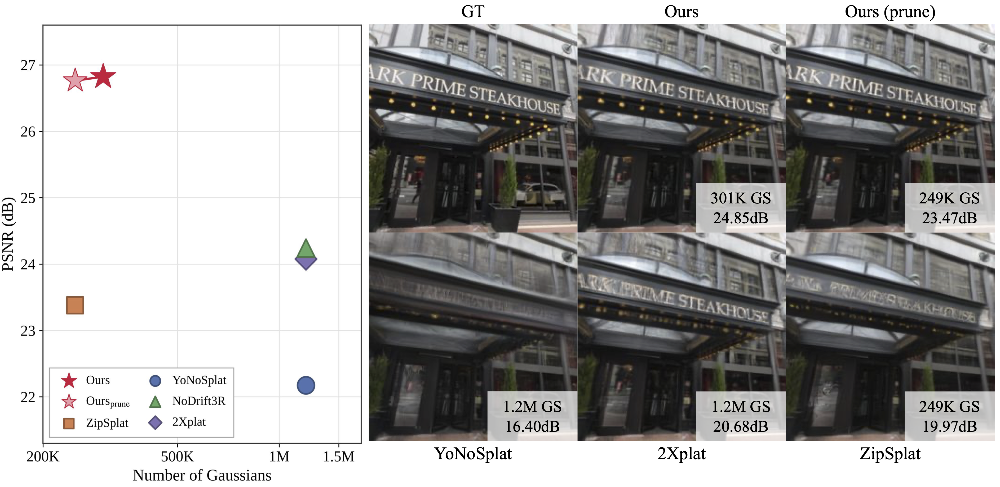

<div align="center">
<h1>FineSplat: Fine Patches, Local Groups, Detailed Splats</h1>

[Hyebin Kim](https://github.com/hyebinny)\*, [Hwasik Jeong](https://github.com/HwasikJeong)\*, [Joonhyuk Park](https://github.com/joonh-park), [Gyeongjin Kang](https://gynjn.github.io/info/), [Jungwoo Kim](https://github.com/jungcow), [Younghyun Kim](https://github.com/yhyun225), [Eunbyung Park](https://silverbottlep.github.io/)

Yonsei University

\*Equal contribution
</div>

<div align="center" style="margin-top: 2em; margin-bottom: 1.0em">
  <a href="https://arxiv.org/abs/XXXX.XXXXX"></a> <a href="https://hyebinny.github.io/FineSplat/"></a> <a href="https://huggingface.co/HyebinKim/FineSplat"></a>
</div>

<div align="center" style="margin-top: 5.0em; margin-bottom: 1.0em">
  
</div>

## Installation

```bash
# 1. Clone the repository
git clone https://github.com/hyebinny/FineSplat.git
cd FineSplat

# 2. Create and activate a conda environment
conda create -n finesplat python=3.12 -y
conda activate finesplat

# 3. Install dependencies
pip install torch==2.10.0 torchvision==0.25.0 torchaudio==2.10.0 --index-url https://download.pytorch.org/whl/cu130
pip install -r requirements.txt

# 4. Install gsplat
pip install git+https://github.com/QitaoZhao/gsplat.git --no-build-isolation
```

## Checkpoints

All checkpoints are on [🤗 Hugging Face](https://huggingface.co/HyebinKim/FineSplat):

| File | Content | Used by |
| ---- | ------- | ------- |
| `finesplat_224res.pt` | FineSplat-224: Stage 1 + Stage 2, fine-tuned end-to-end | evaluation |
| `train/stage1_224res.pt` | Stage 1 (2Xplat, with its DA3 and MVP weights) | training, Stage 2 |
| `train/stage2_224res.pt` | Stage 2 trained on the frozen Stage 1 | training, end-to-end |

```bash
hf download HyebinKim/FineSplat finesplat_224res.pt --local-dir pretrained_weights   # our final model
hf download HyebinKim/FineSplat --include "train/*" --local-dir pretrained_weights
```

so that they sit under `path/to/FineSplat/pretrained_weights/`.

## Datasets

Download DL3DV from the [official repository](https://huggingface.co/DL3DV); we use **DL3DV-ALL-480P** at 224x224. Each
scene is a folder `<split>/<scene id>/` holding the images and an `opencv_cameras.json`.

The configs expect the data under `datasets/` in the repository root:

```
datasets/
  dl3dv_480/<split>/<scene id>/      DL3DV-ALL-480P, data.root (train / test)
```

The context / target view indices for RE10K, ScanNet++ and Mip-NeRF 360 are in `src/data/RE10K/`, `src/data/ScanNetpp/` and `src/data/MipNeRF360/`.

## Evaluation

`src/configs/<dataset>/eval/<N>v/` has a config per camera setting:
`DL3DV/eval/{6v,12v,24v}/{posed,unposed}.yaml`, `RE10K/eval/6v/{posed,unposed}.yaml`,
`ScanNetpp/eval/{32v,64v,128v}/{posed,unposed}.yaml`, `MipNeRF360/eval/{32v,64v,128v}/{posed,unposed}.yaml`.

| Setting | Context cameras | Target cameras |
| ------- | --------------- | -------------- |
| `posed` | GT poses and intrinsics | GT |
| `unposed` | DA3 poses and intrinsics | DA3, then EPA |

EPA (evaluation-time pose alignment) optimizes the target poses for 200 Adam steps against the
rendering before scoring, as in 2Xplat and YoNoSplat.

```bash
# FineSplat, all Gaussians
python -m src.commands.inference_finesplat --config src/configs/DL3DV/eval/6v/posed.yaml

# FineSplat pruned by contribution score
python -m src.commands.eval_prune src/configs/DL3DV/eval/6v/posed.yaml
```

Useful `inference.*` options (in the yaml, or appended to the command as `inference.key=value`):

| Option | Description |
| ------ | ----------- |
| `checkpoint` | `{ckpt_path, use_ema, full_state}` of the FineSplat checkpoint. `ckpt_path: null` evaluates Stage 1 alone. |
| `epa_steps` | Number of EPA steps (default 200). |
| `pose_optimization` | `false` renders at DA3's target poses without EPA. |
| `scene_range` | `[lo, hi]` scores scenes `lo..hi-1` only, to split `eval_prune` across GPUs. |
| `prune_keep_per_view` | Number of Gaussians `eval_prune` keeps per context view (top-k over all Gaussians). |

## Training

Stage 1 is trained with [2Xplat](https://github.com/HwasikJeong/2Xplat)'s own recipe. Stage 2 is first trained on the frozen Stage 1 with GT cameras, and the whole model is then fine-tuned end-to-end in the pose-free setting.

```bash
# Stage 2 on the frozen Stage 1
torchrun --nproc_per_node 4 -m src.commands.train_finesplat --config src/configs/DL3DV/train/stage2.yaml

# end-to-end fine-tuning
torchrun --nproc_per_node 8 -m src.commands.train_finesplat --config src/configs/DL3DV/train/e2e.yaml
```

## Related Projects

This project builds on many excellent research works. We thank the authors for sharing their code.

- [2Xplat](https://github.com/HwasikJeong/2Xplat)
- [MVP](https://github.com/Gynjn/MVP)
- [Point Transformer V3](https://github.com/Pointcept/PointTransformerV3)
- [Depth Anything 3](https://github.com/ByteDance-Seed/Depth-Anything-3)

## Citation

If you find our work useful, please cite:

```bibtex
@article{kim2026finesplat,
          title={FineSplat: Fine Patches, Local Groups, Detailed Splats},
          author={Hyebin Kim and Hwasik Jeong and Joonhyuk Park and Gyeongjin Kang and Jungwoo Kim and Younghyun Kim and Eunbyung Park},
          journal={arXiv preprint arXiv:XXXX.XXXXX},
          year={2026}
}
```
