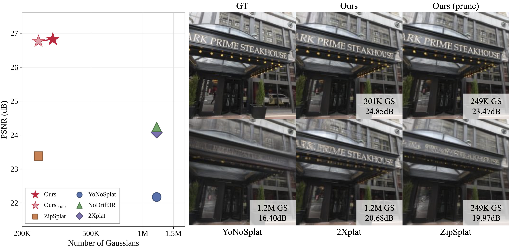

<div align="center">
<h1>FineSplat: Fine Patches, Local Groups, Detailed Splats</h1>

[Hyebin Kim](https://github.com/hyebinny)\*, [Hwasik Jeong](https://github.com/HwasikJeong)\*, [Joonhyuk Park](https://github.com/joonh-park), [Gyeongjin Kang](https://gynjn.github.io/info/), [Jungwoo Kim](https://github.com/jungcow), [Younghyun Kim](https://github.com/yhyun225), [Eunbyung Park](https://silverbottlep.github.io/)

Yonsei University

\*Equal contribution
</div>

<div align="center" style="margin-top: 2em; margin-bottom: 1.0em">
  <a href="https://arxiv.org/abs/2610.25011"></a> <a href="https://hyebinny.github.io/FineSplat/"></a> <a href="https://huggingface.co/HyebinKim/FineSplat"></a>
</div>

<div align="center" style="margin-top: 5.0em; margin-bottom: 1.0em">
  
</div>

## Highlights

🧩 **Fine-grained patches**: 4×4-pixel patches for detail-preserving reconstruction  
🪶 **Fewer Gaussians**: 4× fewer than pixel-aligned Gaussians  
💎 **Lightweight representation**: SH degree 1 for color, view-independent opacity  
✨ **High rendering quality**  
⚡ **Fast inference**  
📷 **RGB-only supervision**: no depth supervision

## Installation

```bash
# 1. Clone the repository
git clone https://github.com/hyebinny/FineSplat.git
cd FineSplat

# 2. Create and activate a conda environment
conda create -n finesplat python=3.12 -y
conda activate finesplat

# 3. Install dependencies
pip install torch==2.10.0 torchvision==0.25.0 torchaudio==2.10.0 --index-url https://download.pytorch.org/whl/cu130
pip install -r requirements.txt

# 4. Install gsplat
pip install git+https://github.com/QitaoZhao/gsplat.git --no-build-isolation
```

## Checkpoints

All checkpoints are on [🤗 Hugging Face](https://huggingface.co/HyebinKim/FineSplat):

| File | Content | Used by |
| ---- | ------- | ------- |
| `finesplat_224res.pt` | FineSplat-224: Stage 1 + Stage 2, fine-tuned end-to-end | evaluation |
| `train/stage1_224res.pt` | Stage 1 | training, Stage 2 |
| `train/stage2_224res.pt` | Stage 2 trained on the frozen Stage 1 | training, end-to-end |

```bash
hf download HyebinKim/FineSplat finesplat_224res.pt --local-dir pretrained_weights
# Stage 1 / Stage 2 checkpoints, for training or Stage-1-only evaluation
hf download HyebinKim/FineSplat --include 'train/*' --local-dir pretrained_weights
```

so that they sit under `path/to/FineSplat/pretrained_weights/`.

## Datasets

We provide the processed datasets on [🤗 Hugging Face](https://huggingface.co/datasets/HwasikJeong/FineSplat_Datasets). They are downloaded from each dataset's official source and converted to the format our code expects.

| Dataset | Used for |
| ------- | -------- |
| DL3DV | train & test |
| RealEstate10K | test |
| ScanNet++v2 | test |
| Mip-NeRF360 | test |

Place them under `datasets/` in the repository root:

```
datasets/
  dl3dv_480/<split>/<scene id>/      # DL3DV-ALL-480P, data.root (train / test)
  re10k/<scene id>/                  # RealEstate10K
  scannetpp/<scene id>/              # ScanNet++v2
  mipnerf360/<scene id>/             # Mip-NeRF360
```

The context and target view indices used for evaluation are listed in `src/data/<dataset>/`.

## Evaluation

`src/configs/<dataset>/eval/<N>v/` has a config per camera setting:
`DL3DV/eval/{6v,12v,24v}/{posed,unposed}.yaml`

| Setting | Context cameras | Target cameras |
| ------- | --------------- | -------------- |
| `posed` | GT poses and intrinsics | GT |
| `unposed` | Estimated poses and intrinsics | Estimated, then EPA |

EPA (evaluation-time pose alignment) optimizes the target poses for 200 Adam steps against the
rendering before scoring, following prior pose-free methods.

```bash
# FineSplat, all Gaussians
python -m src.commands.inference_finesplat --config src/configs/DL3DV/eval/6v/posed.yaml

# FineSplat pruned by contribution score
python -m src.commands.eval_prune src/configs/DL3DV/eval/6v/posed.yaml
```

Useful `inference.*` options (in the yaml, or appended to the command as `inference.key=value`):

| Option | Description |
| ------ | ----------- |
| `checkpoint` | `ckpt_path`: the FineSplat checkpoint (`pretrained_weights/finesplat_224res.pt`), EMA weights by default (`use_ema: true`). |
| `ckpt_path` | Stage 1 checkpoint. Not needed with the FineSplat checkpoint above, which already contains Stage 1. To evaluate Stage 1 alone: `inference.checkpoint.ckpt_path=null inference.ckpt_path=pretrained_weights/train/stage1_224res.pt`. |
| `pose_optimization` | Whether to run EPA in the pose-free setting; `false` renders at the estimated target poses. |
| `epa_steps` | Number of EPA steps (default 200). |
| `prune_keep_per_view` | Number of Gaussians `eval_prune` keeps per context view (top-k over all Gaussians). |

## Training

**Stage 1.** The appearance backbone follows the [MVP](https://github.com/Gynjn/MVP) architecture, with view-independent opacity instead of MVP's view-dependent opacity, and is trained in two steps: the original pixel-aligned MVP from scratch (color SH degree 0), then fine-tuned with the 4×4-patch head (color SH degree 1).  The pretrained head is converted to the patch layout when loaded (`Stage1Model._expand_gaussian_head`). The geometry backbone and the appearance backbone are then jointly trained in the pose-free setting following [2Xplat](https://github.com/HwasikJeong/2Xplat). The configs are in `src/configs/DL3DV/train/stage1/`:

```bash
# appearance backbone, from the MVP repository
torchrun --nproc_per_node <num_gpus> train.py --config path/to/FineSplat/src/configs/DL3DV/train/stage1/app_backbone_pretrain.yaml
torchrun --nproc_per_node <num_gpus> train.py --config path/to/FineSplat/src/configs/DL3DV/train/stage1/app_backbone_finetune.yaml

# Stage 1 (geometry + appearance backbone), from the 2Xplat repository
torchrun --nproc_per_node <num_gpus> -m src.commands.train --config path/to/FineSplat/src/configs/DL3DV/train/stage1/stage1.yaml
```

The trained Stage 1 is released as `train/stage1_224res.pt`.

**Stage 2.** Stage 2 is first trained on the frozen Stage 1 with GT cameras, and the whole model is then fine-tuned end-to-end in the pose-free setting, which gives the final FineSplat checkpoint.

```bash
# Stage 2 on the frozen Stage 1
torchrun --nproc_per_node <num_gpus> -m src.commands.train_finesplat --config src/configs/DL3DV/train/stage2/stage2.yaml

# end-to-end fine-tuning
torchrun --nproc_per_node <num_gpus> -m src.commands.train_finesplat --config src/configs/DL3DV/train/finesplat/end_to_end.yaml
```

## Related Projects

This project builds on many excellent research works. We thank the authors for sharing their code.

- [Depth Anything 3](https://github.com/ByteDance-Seed/Depth-Anything-3)
- [MVP](https://github.com/Gynjn/MVP)
- [2Xplat](https://github.com/HwasikJeong/2Xplat)
- [Point Transformer V3](https://github.com/Pointcept/PointTransformerV3)

## Citation

If you find our work useful, please cite:

```bibtex
@article{kim2026finesplat,
          title={FineSplat: Fine Patches, Local Groups, Detailed Splats},
          author={Hyebin Kim and Hwasik Jeong and Joonhyuk Park and Gyeongjin Kang and Jungwoo Kim and Younghyun Kim and Eunbyung Park},
          journal={arXiv preprint arXiv:2610.25011},
          year={2026}
}
```
